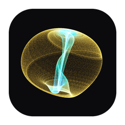
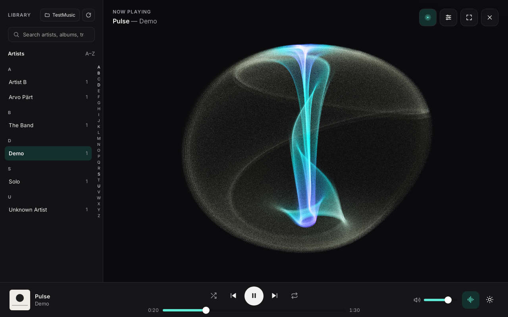
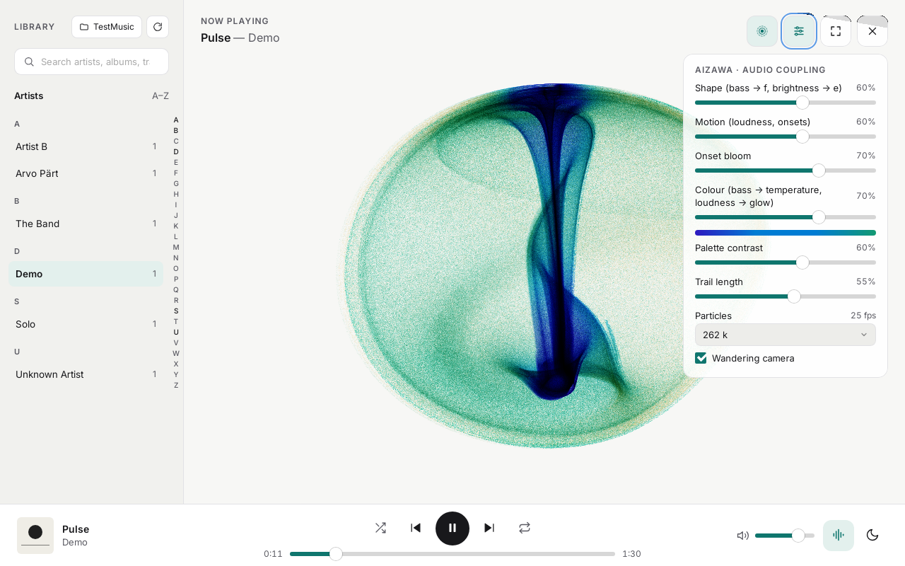

<p align="center"></p>

<h1 align="center">Musica</h1>

<p align="center">An offline music player for Windows, macOS and Linux, with an audio-reactive strange-attractor visualizer.</p>

<p align="center"></p>

---

Musica plays the music in a folder on your computer. It reads the tags of every file, sorts your library by artist, picks up album artwork, and has a visualizer in which a cloud of particles flows along the Aizawa attractor while the music reshapes and colours it. No accounts, no streaming, no network access.

## Features

- **Library from a folder.** Choose a folder once; Musica scans it (including sub-folders) and remembers it. Use the rescan button or <kbd>Ctrl/⌘+R</kbd> after adding music.
- **Open a folder from the command line**: `musica /path/to/music` (also used by "Open with Musica" in file managers).
- **Sorted by artist.** Uses the *album artist* tag, then *artist*, then the folder name. A leading "The" is ignored when sorting. Albums are ordered by year, tracks by disc and track number.
- **Album covers.** Any image in an album folder is used as its cover. With several images, one named `cover`, `folder`, `front`, `album` or `artwork` wins; otherwise the largest. Artwork embedded in the files is used when the folder has no image.
- **Player.** Play/pause, previous/next, shuffle, repeat (all / one), seek, volume, search, OS media keys where the system webview supports them.
- **Light and dark themes** (light theme below), a resizable sidebar, and the window remembers your theme, volume and sidebar width.
- **Visualizer** (<kbd>V</kbd>): around 260 000 particles (adjustable up to 1 million) simulated on the GPU along the Aizawa attractor.
  - *Bass* and *spectral brightness* slightly change the attractor's parameters, inside a range where it stays chaotic.
  - *Loudness* and *onsets* change the speed of the flow.
  - *Bass* sets the colour temperature (cool ↔ warm); *loudness* sets saturation and glow; colour along the flow follows particle speed.
  - *Onset bloom*: each attack swells and twists the cloud for about 0.3 s.
  - A wandering camera drifts, tilts and rolls around the attractor. Drag to steer it, scroll to zoom.

<p align="center"></p>

## Install

Download the file for your system from the [latest release](../../releases/latest).

| System | File |
|---|---|
| Windows 10/11 | `Musica_x.y.z_x64-setup.exe` (or `.msi`) |
| macOS 11+ (Apple Silicon) | `Musica_x.y.z_aarch64.dmg` |
| macOS 11+ (Intel) | `Musica_x.y.z_x64.dmg` |
| Linux | `.AppImage` (any distribution), `.deb` (Debian, Ubuntu, Mint) or `.rpm` (Fedora, openSUSE) |

The builds are not code-signed, so the first launch needs one extra step:

- **Windows:** if SmartScreen says "Windows protected your PC", click **More info → Run anyway**.
- **macOS:** right-click Musica in Applications and choose **Open**, then **Open** again. If macOS says the app "is damaged", run `xattr -dr com.apple.quarantine /Applications/Musica.app` in Terminal once.
- **Linux AppImage:** make it executable (`chmod +x Musica_*.AppImage`) and run it.

## Supported formats

Musica plays files through the system's web engine when it can, and otherwise decodes them itself (to uncompressed audio) with [Symphonia](https://github.com/pdeljanov/Symphonia), so playback does not depend on what codecs the system happens to have.

| Format | Windows | macOS | Linux |
|---|---|---|---|
| MP3, FLAC, WAV, AIFF, AAC / ALAC (`.m4a`), Ogg Vorbis | ✓ | ✓ | ✓ |
| Opus | ✓ | ✓ on recent macOS | ✓ with GStreamer's Opus plugin (installed by default on most desktops) |

Opus is the one format Musica cannot decode itself; it relies on the system for it.

On Linux the `.deb` and `.rpm` packages pull in the usual GStreamer plugins. With the AppImage, files the system can't play are decoded by Musica instead.

## Keyboard shortcuts

| Key | Action |
|---|---|
| <kbd>Space</kbd> | Play / pause |
| <kbd>←</kbd> / <kbd>→</kbd> | Seek 5 s |
| <kbd>V</kbd> | Open / close the visualizer |
| <kbd>F</kbd> | Visualizer fullscreen |
| <kbd>B</kbd> | Onset bloom on / off (in the visualizer) |
| <kbd>Esc</kbd> | Close the visualizer |
| <kbd>L</kbd> | Light / dark theme |
| <kbd>Ctrl/⌘+F</kbd> | Search |
| <kbd>Ctrl/⌘+O</kbd> | Choose music folder |
| <kbd>Ctrl/⌘+R</kbd> | Rescan music folder |

## Build from source

Requirements: [Rust](https://rustup.rs) (stable), [Node.js](https://nodejs.org) 18+, and the [Tauri prerequisites](https://tauri.app/start/prerequisites/) for your system (on Linux: `libwebkit2gtk-4.1-dev`, `libappindicator3-dev`, `librsvg2-dev`, `patchelf`).

```bash
npm install
npm run dev      # run with live reload of the interface
npm run build    # build installers into src-tauri/target/release/bundle/
```

Tests for the scanner and decoder run against a folder of your choice:

```bash
cd src-tauri
MUSICA_TEST_DIR=/path/to/some/music cargo test -- --nocapture
```

## Publishing a release

1. Set the new version in `src-tauri/tauri.conf.json`, `src-tauri/Cargo.toml` and `package.json`.
2. Commit, then tag and push:
   ```bash
   git tag v0.2.0
   git push origin main v0.2.0
   ```
3. The **Release** workflow builds Windows, macOS (Apple Silicon and Intel) and Linux installers in parallel (about 15–20 minutes) and attaches them to a **draft** release.
4. Open the draft under *Releases*, check the notes and click **Publish**.

The workflow can also be started by hand from the *Actions* tab.

## How it is built

| Part | Technology |
|---|---|
| Window and packaging | [Tauri 2](https://tauri.app): the system webview (WebView2, WKWebView, WebKitGTK) with a small Rust core; a few-MB installers (the AppImage, which bundles the web engine, is about 80 MB) |
| Interface | Plain HTML, CSS and JavaScript in `src/index.html`; no framework, no build step |
| Visualizer | WebGL2: particle state in float textures, RK4 integration on the GPU, additive trails with tone mapping |
| Library scan | Rust: [`walkdir`](https://crates.io/crates/walkdir) + [`lofty`](https://crates.io/crates/lofty) for tags and embedded artwork |
| Audio | The webview's media engine and the Web Audio API for analysis; [`symphonia`](https://crates.io/crates/symphonia) decodes formats the webview can't play |

```
src/                    interface (HTML/CSS/JS), bundled Inter font
src-tauri/src/lib.rs    commands: pick_folder, scan_library, read_file, embedded_cover, decode_wav
src-tauri/src/library.rs  folder scan, tag reading, cover selection
src-tauri/src/decode.rs   fallback decoder → WAV
scripts/make_icon.py    renders the app icon from the Aizawa attractor
.github/workflows/      CI and release builds
```

The interface can only read files inside the music folder you chose.

## License

MIT, see [LICENSE](LICENSE). The bundled Inter typeface is © The Inter Project Authors, under the SIL Open Font License 1.1 ([`src/fonts/OFL.txt`](src/fonts/OFL.txt)).
